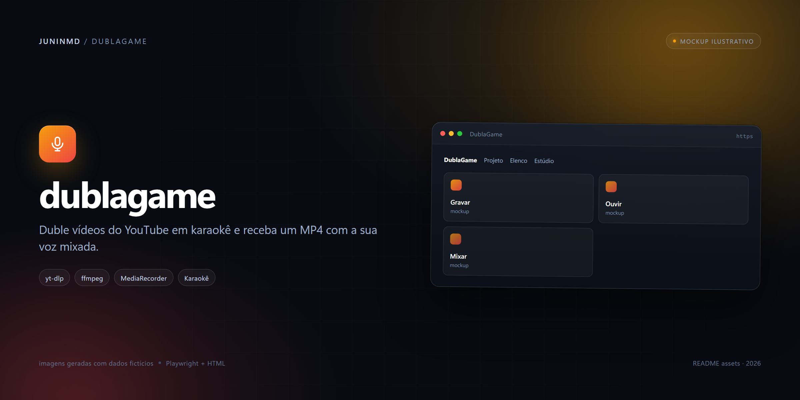
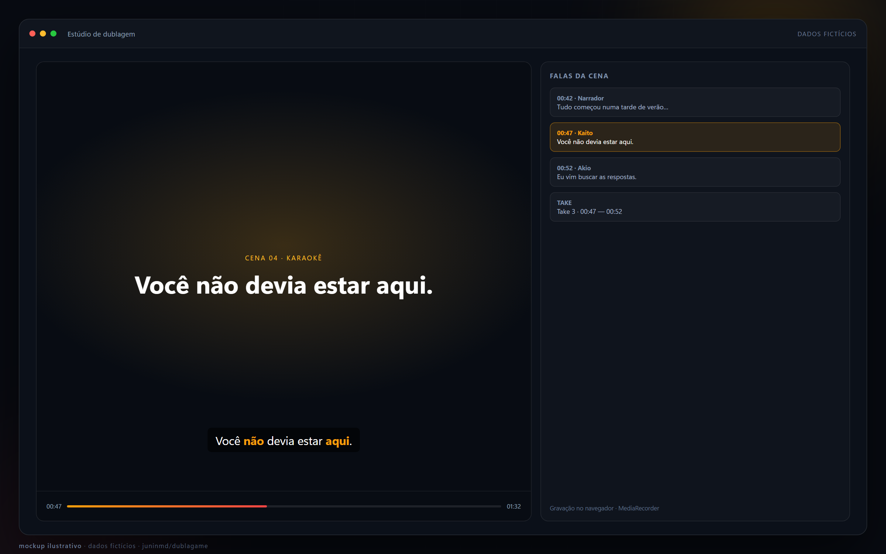

# 🎙️ dublagame

<p align="center">
  
</p>

**Duble vídeos do YouTube em karaokê: a legenda acende palavra por palavra, o navegador grava sua voz e o app devolve um MP4 com a sua dublagem mixada.**

App web auto-hospedado que baixa vídeo e legenda com `yt-dlp`, separa as falas por personagem, grava cada jogador no `MediaRecorder` e monta o vídeo final com `ffmpeg`. Serve para brincar de dublagem com os amigos, sem instalar nada além de um navegador.

**Índice:** [O que faz](#o-que-faz) · [Como funciona](#como-funciona) · [Requisitos](#requisitos) · [Rodar local](#rodar-local) · [Configuração](#configuração) · [Uso](#uso) · [API](#api) · [Arquitetura](#arquitetura) · [Direitos autorais](#direitos-autorais-e-uso-responsável) · [Deploy](#deploy) · [Testes](#testes-e-ci) · [Limitações](#limitações) · [Licença](#licença)

## O que faz

| | |
| --- | --- |
| **Ingestão por link** | Aceita `youtube.com/watch?v=`, `youtu.be`, `/shorts/`, `/embed/` e `/live/`, ou o ID de 11 caracteres. Baixa o vídeo em até 720p e a melhor legenda disponível. |
| **Karaokê por palavra** | Legendas `json3` trazem o tempo de cada palavra. Quando só há `.vtt`/`.srt`, as palavras são distribuídas dentro do intervalo da fala. |
| **Elenco editável** | Prefixos `NOME:` na legenda viram personagens automaticamente. Sem prefixo, uma IA opcional (gateway compatível com OpenAI) ou a heurística cria o elenco, e a tela permite renomear e reatribuir cada fala. |
| **Gravação no navegador** | O microfone é lido por `getUserMedia`, a voz é gravada em WebM/Opus e o volume é amostrado a cada 40 ms para pontuar. Há modo treino que pontua sem gravar. |
| **Placar** | Cada fala vale de 0 a 100 (65% de cobertura da fala + 35% de encaixe no tempo). Acertos seguidos dão combo, e o ranking guarda a média por fala de cada take. |
| **Render final** | Junta os takes escolhidos num MP4: o áudio original é silenciado exatamente nas janelas dos personagens dublados, e as vozes entram no tempo compensado pelo offset da gravação. |
| **Persistência** | Vídeos, takes e renders ficam em SQLite + arquivos sob `DATA_DIR`; o vídeo é servido com HTTP Range para permitir busca na timeline. |

## Como funciona

| Etapa | O que acontece |
| --- | --- |
| **Ingest** | `yt-dlp --dump-json` lê título, duração e transmissão ao vivo; depois baixa vídeo (`height<=720`, MP4) e legendas em `pt-BR,pt,pt-orig,en,en-orig`, preferindo `json3` e português. |
| **Falas** | `parseJson3` descarta eventos parciais do modo *rollup* do YouTube, remove marcações como `[Music]` e junta falas curtas (< 1,2 s) grudadas na anterior. `parseVtt` cobre legendas manuais. |
| **Elenco** | `detectCharacters` tenta prefixo de orador (`NOME: fala`, presente em pelo menos metade das falas e com 2 a 6 nomes); se falhar e a IA estiver ligada, pede no máximo 4 personagens ao modelo; senão, tudo vira um personagem só. |
| **Partida** | O jogador escolhe um ou mais personagens, o vídeo toca e o app pinta as palavras conforme `words[].t`. O áudio original é zerado enquanto o personagem do jogador fala, para não vazar no microfone. |
| **Pontuação** | Para cada fala: cobertura = proporção de amostras acima do ruído de fundo; timing = 1 − \|atraso\|/1,2 s. Nota = `100 × (0,65 × cobertura + 0,35 × timing)`. |
| **Render** | `render.ts` constrói um `-filter_complex`: volume 0 no original durante as janelas dubladas, highpass/compressor/ganho em cada take, `amix` sem normalização e limitador em 0,95. O vídeo é copiado sem reencode; o áudio sai em AAC 192 kbps. |

## Requisitos

- [Bun](https://bun.sh) — a imagem oficial do projeto usa Bun 1.2.
- `ffmpeg` no `PATH` (a mixagem e o corte do áudio).
- `yt-dlp` no `PATH` (download do vídeo e das legendas).
- Navegador com `MediaRecorder` e `AudioContext` (Chrome/Edge atuais). O microfone só é liberado em `localhost` ou HTTPS.
- Para o teste E2E: Node.js e Playwright/Chromium.

## Rodar local

```bash
bun install
cp .env.example .env
bun run dev            # http://localhost:3000
```

No PowerShell, troque o `cp` por `Copy-Item .env.example .env`.

Os scripts disponíveis em `package.json` são:

| Comando | O que faz |
| --- | --- |
| `bun run dev` | `bun --watch src/index.ts` — servidor com reload. |
| `bun run start` | `bun src/index.ts` — servidor sem watch. |

Na primeira execução, `config.ts` cria `./data/videos` e o SQLite em `./data/dublagame.db`.

## Configuração

Todas as variáveis são lidas de `process.env` (o Bun carrega o `.env` automaticamente). Os valores abaixo são os padrões do código.

| Variável | Padrão | Para quê |
| --- | --- | --- |
| `PORT` | `3000` | Porta HTTP. |
| `DATA_DIR` | `./data` | Raiz do SQLite, vídeos, takes e renders. |
| `MAX_DURATION_SEC` | `900` | Recusa vídeos mais longos que 15 minutos (a UI também anuncia esse limite). |
| `YTDLP_COOKIES` | vazio | Caminho para um arquivo de cookies no formato Netscape, útil quando o IP do servidor cai no bot check do YouTube. |
| `OPENAI_BASE_URL` | vazio | URL do gateway compatível com OpenAI (ex.: LiteLLM). |
| `OPENAI_API_KEY` | vazio | Chave do gateway; a IA só liga com URL **e** chave. |
| `OPENAI_MODEL` | `cloud/auto` | Modelo usado na rotulagem automática de personagens. |
| `YTDLP_BIN` | `yt-dlp` | Caminho alternativo do executável `yt-dlp`. |
| `FFMPEG_BIN` | `ffmpeg` | Caminho alternativo do executável `ffmpeg`. |

O `.env.example` traz `OPENAI_MODEL=cloud/gemma3` como exemplo; o padrão do código é `cloud/auto`. Sem IA configurada, o app continua funcionando com a detecção por prefixo e o editor manual de elenco.

## Uso

1. **Prepare o vídeo.** Cole o link na página inicial. O status passa por `pending` → `downloading` → `ready` (ou `error`, com a mensagem do `yt-dlp`).
2. **Confira o elenco.** Em `/jogar/<id>`, o editor lista cada fala com seu personagem. Renomeie, crie personagens (até 6) e salve; a alteração vale para todos os jogadores.
3. **Escolha seu personagem.** Marque um ou mais chips de elenco. O botão de gravar só libera com pelo menos um selecionado.
4. **Grave.** O app começa a gravar, faz uma contagem de 3 segundos e dá play do início; a legenda acende e o offset entre o início da gravação e o play é enviado junto com o take. A voz original do seu personagem é silenciada; a dos outros continua.
5. **Veja a nota.** Ao terminar, a média das falas é enviada junto com o take. O placar ordena por essa nota; o botão de lixeira apaga o take e o arquivo WebM.
6. **Renderize.** Marque os takes que entram na mixagem e gere o MP4. O resultado fica disponível para tocar e baixar em `/media/<videoId>/render/<renderId>.mp4`.

O modo **treino** pontua a leitura sem pedir microfone e sem gravar nada.

### Quem dubla o quê

Cada take declara os personagens que cobriu. No render, a união dos personagens de todos os takes define as janelas em que o áudio original é zerado (com 0,25 s de margem e janelas próximas fundidas). Fora delas, o áudio original — outros personagens, trilha, efeitos — permanece intacto.

O `offset` enviado pelo navegador é o instante do vídeo em que a gravação começou. Offset negativo (gravou antes do play) corta a cabeça do áudio; positivo atrasa o take com `adelay`.

## API

| Método | Rota | O que faz |
| --- | --- | --- |
| `POST` | `/api/videos` | Recebe `{ "url": "..." }`, extrai o ID e dispara a ingestão em background. |
| `GET` | `/api/videos` | Lista os 30 vídeos mais recentes. |
| `GET` | `/api/videos/:id` | Devolve metadados, elenco, falas e takes. |
| `PUT` | `/api/videos/:id/cast` | Renomeia/cria personagens e reatribui falas. |
| `POST` | `/api/videos/:id/takes` | Recebe `multipart/form-data` com `audio`, `player`, `characters`, `offset`, `score` e `detail`. |
| `DELETE` | `/api/takes/:id` | Apaga o take e o WebM correspondente. |
| `POST` | `/api/videos/:id/render` | Recebe `{ "takeIds": ["..."] }` e agenda a mixagem. |
| `GET` | `/api/renders/:id` | Consulta o status (`rendering`, `ready`, `error`) e a URL do MP4. |
| `GET` | `/media/:id/video.mp4` | Serve o vídeo original com Range. |
| `GET` | `/media/:id/render/:file` | Serve o MP4 renderizado. |
| `GET` | `/healthz` | Responde `{ "ok": true }`. |

As páginas são `/` (início) e `/jogar/:id` (sala). CSS e JS saem de `/assets/:file`; os nomes de arquivo são saneados antes de virar caminho.

## Arquitetura

```text
src/
  index.ts       rotas Hono, streaming com Range, upload de take, render
  pipeline.ts    yt-dlp (metadados + download), escolha da legenda, ingestão async
  subs.ts        parsers json3/vtt e fusão de falas curtas
  characters.ts  detecção por prefixo, IA opcional e fallback de um personagem
  render.ts      filter_complex do ffmpeg e execução assíncrona
  db.ts          schema SQLite (videos, takes, renders) e helpers
  config.ts      env vars, diretórios e constantes
public/
  index.html     formulário de link e vídeos recentes
  play.html      sala: elenco, karaokê, HUD, placar e render
  game.js        gravação, pontuação, combo, polling do render
  home.js        lista de vídeos já preparados
  app.css        estilos
test/smoke.mjs   E2E com microfone falso do Chromium
```



```mermaid
flowchart LR
  LINK["link do YouTube"] --> API["POST /api/videos"]
  API --> YT["yt-dlp<br/>vídeo + legenda"]
  YT --> SUB["subs.ts<br/>falas com tempo"]
  SUB --> CAST["characters.ts<br/>elenco"]
  CAST --> UI["sala /jogar/:id"]
  UI --> MIC["MediaRecorder + AnalyserNode"]
  MIC --> TAKE["POST takes<br/>WebM + nota"]
  TAKE --> DB[("SQLite + DATA_DIR")]
  DB --> REN["render.ts<br/>ffmpeg"]
  REN --> MP4["MP4 com a dublagem"]
```

### O que fica no disco

```text
$DATA_DIR/
  dublagame.db          SQLite em modo WAL
  videos/<id>/video.mp4 vídeo baixado
  videos/<id>/takes/    um .webm por take
  videos/<id>/renders/  um .mp4 por render
```

O schema tem três tabelas (`videos`, `takes`, `renders`) e um índice por `video_id` em `takes`. O status do vídeo é um dos quatro valores `pending`, `downloading`, `ready` e `error`; a mensagem de erro é truncada em 400 caracteres antes de ir para o banco.

## Direitos autorais e uso responsável

- O app **baixa o vídeo no servidor** com `yt-dlp`. Baixar conteúdo do YouTube pode contrariar os Termos de Serviço da plataforma; quem opera a instância assume esse risco.
- A dublagem é uma obra derivada. Você precisa de autorização ou de uma base legal para usar o vídeo, a letra, a música e a imagem — "está público no YouTube" não é licença.
- Não use a instância pública para redistribuir conteúdo de terceiros, e não trate o MP4 gerado como licenciado para uso comercial.
- Vídeos e takes ficam no `DATA_DIR` **sem autenticação**: qualquer pessoa com acesso à URL vê o material. Não suba conteúdo sensível nem deixe a instância aberta sem controle de acesso.

## Deploy

O `Dockerfile` usa `oven/bun:1.2-debian`, instala `ffmpeg` e o binário estático do `yt-dlp`, roda como usuário `app` (UID 10001), expõe a porta 3000 e declara `VOLUME ["/data"]` com healthcheck em `/healthz`.

Build e execução local da imagem:

```bash
docker build -t dublagame .
docker run --rm -p 3000:3000 \
  -v dublagame-data:/data \
  --env-file .env \
  dublagame
```

O workflow `Build and Push Docker Image` está configurado para publicar `ghcr.io/juninmd/dublagame-app` a cada push na `master` (ou por `workflow_dispatch`). Para publicar manualmente:

```bash
gh auth token | docker login ghcr.io -u juninmd --password-stdin
docker build --platform linux/amd64 -t ghcr.io/juninmd/dublagame-app:latest .
docker push ghcr.io/juninmd/dublagame-app:latest
```

O manifesto de Kubernetes fica no repositório `app-charts`, pasta `dublagame` (Deployment, Service, Ingress e PVC). A imagem usa `/data` como `DATA_DIR`, então o PVC precisa estar montado nesse caminho.

## Testes e CI

O smoke E2E joga uma partida de verdade: chama a API, espera o vídeo ficar `ready`, abre o Chromium com microfone falso, verifica o karaokê, grava, confere a nota, envia o take e renderiza o MP4.

```bash
bunx playwright install chromium
node test/smoke.mjs http://localhost:3000
```

Ele precisa de rede (baixa um vídeo real) e escreve no `DATA_DIR` do servidor. O segundo argumento opcional permite trocar o vídeo de teste; o padrão do script é `https://youtu.be/jNQXAC9IVRw`.

| Workflow | O que checa |
| --- | --- |
| `validate.yml` | Validação de PR/push na `master` pelo workflow reutilizável de `juninmd/base-actions`. |
| `sast.yml` | Análise estática (Semgrep) em `main`/`master` e sob demanda; no primeiro ciclo o relatório não bloqueia. |
| `security.yml` | Varredura de segurança semanal e no push para `master`. |
| `docker.yml` | Build e push da imagem no GHCR. |
| `dependabot-auto-merge.yml` | Auto-merge de PRs do Dependabot quando todos os checks passam. |

## Imagens

> [!NOTE]
> **Mockups ilustrativos.** As telas abaixo foram geradas em HTML com dados fictícios (Playwright) e não são capturas de uma instalação real.

<p align="center">
  
  <br>
  <sub>Estúdio de dublagem — dados fictícios.</sub>
</p>


## Limitações

- **Sem legenda, sem jogo.** O vídeo precisa ter legenda manual ou automática; com menos de duas falas, a ingestão falha.
- **A legenda automática não diz quem fala.** A separação por personagem é palpite (prefixo, IA ou heurística) e o editor da sala existe para corrigir.
- **Limite padrão de 15 minutos**, definido por `MAX_DURATION_SEC`. Transmissões ao vivo são recusadas.
- **Download e render rodam no servidor**, não no navegador. O IP da instância pode cair no bot check do YouTube; a saída é fornecer `YTDLP_COOKIES`.
- **Até 6 personagens** por vídeo e **120 MB** por take de áudio.
- **Sem login, sem salas privadas.** Qualquer pessoa com o link do vídeo vê e usa os takes.
- **Uma faixa por take.** Cada jogador grava a passada inteira; não há edição fala a fala depois da gravação.
- O render copia o vídeo sem reencode, então o MP4 final tem o mesmo codec e resolução do download (até 720p); só o áudio é recodificado.
- O placar ao vivo usa combo (até +25%), mas a nota persistida e usada no ranking é a média simples das falas.

## Licença

Não há arquivo de licença neste repositório. O código é disponibilizado como está, sem licença de uso declarada; para reutilizar, procure o autor.
